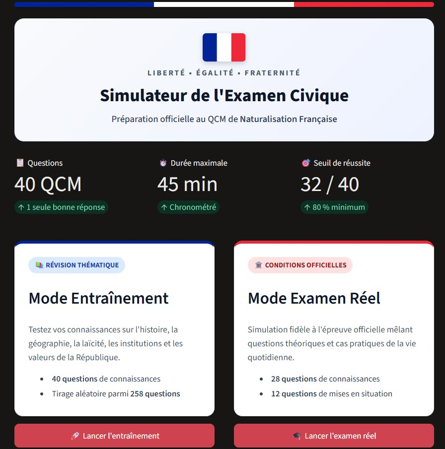

# Simulateur de l’examen civique pour la naturalisation

Ce simulateur permet de préparer l’examen civique demandé dans le cadre d’une **naturalisation** ou d’une **réintégration dans la nationalité française**.

Il reproduit les principales conditions de l’examen :

- **40 questions** ;
- **45 minutes** ;
- au moins **32 bonnes réponses sur 40** pour réussir.

## Fonctionnalités

- **Mode entraînement** : 40 questions portant sur les cinq thèmes officiels :
  - principes et valeurs de la République ;
  - institutions françaises et européennes ;
  - droits et devoirs ;
  - histoire, géographie et culture ;
  - vie dans la société française.
- **Mode examen** : 28 questions de connaissances et 12 mises en situation, sélectionnées aléatoirement.
- **Chronomètre** : durée limitée à 45 minutes.
- **Résultat immédiat** : affichage du score obtenu.
- **Correction finale** : présentation des erreurs et des bonnes réponses.

## Contenu du projet

- `app.py` : application Streamlit ;
- `questions_connaissance.json` : 258 questions de connaissances ;
- `questions_situation.json` : 45 mises en situation ;
- `requirements.txt` : dépendances Python ;
- `Dockerfile` : configuration du conteneur.

## Accéder au simulateur

### Préparez-vous dans les conditions de l’examen

[**Ouvrir le simulateur sur Streamlit**](https://examenciviquenaturalisation.streamlit.app/)

